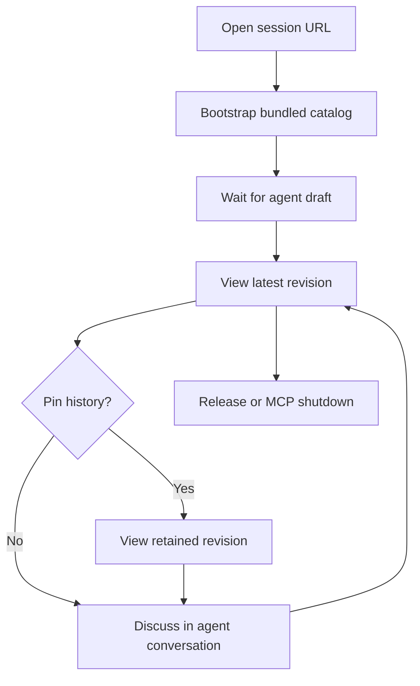

# UX Specification: UI Studio

## Current addition: process-local dashboard

The user selected one dashboard per MCP process, not aggregation across harnesses, and explicitly retained random ports for parallel projects/harnesses. After the first board is acquired, the agent shares http://localhost:<acquired-port>/ to show this process's active boards. The OS allocates the port once and the process reuses it for all later acquisitions and root visits until connection shutdown. No fixed port, new port configuration or cross-process coordination. Existing acquired boards remain memory-only and disappear on release/owning MCP shutdown, with no expiration timer.

Dashboard journey: acquire a descriptively titled board with optional caller-supplied chat label → visit root → identify title/label/acquired time/short unique id/current revision → open board → use unchanged large canvas/history → release → native Refresh removes that board. No automatic chat detection, transcript/chat duplication, editable notes, cross-process registry, source/event preview or release controls. Refresh is a native navigation link; no polling or automatic page reload. Root intentionally exposes this process's capability links to local root visitors, protected by exact loopback Host and same-origin navigation policy.

Layout: one compact Carbon heading/Refresh region followed by a responsive vertical list of stock Carbon tiles and Open board links, maximum readable width centered on desktop; mobile stacks text and actions without horizontal overflow. Only two regions, so no additional wireframe is required. Use existing official Carbon styles/System White-g100; no custom palette/widget skin. Empty state says no active boards and explains acquisition. Loading is browser navigation; root/network error uses normal browser recovery/Refresh. Native links/buttons retain Carbon hover/active/focus/disabled conventions; disabled/locked/success mutation states are inapplicable because dashboard is read-only. Escape/focus and history behavior inside boards are unchanged. All labels use escaped Hono JSX. New dashboard protocol/browser acceptance is required; earlier canvas verification is retained, not new-dashboard proof.

Current visual revision: replace the custom Carbon-colored shell with the pinned official Carbon CSS components and White/g100 Sass themes. Hono SSR uses verified Carbon button/select markup; dynamic history actions use official button variants. Only canvas/sidebar geometry remains application CSS. Load the existing compiled official stylesheet in the host; no second styling framework or new dependency. Native System/Light/Dark behavior, independent White preview and all canvas/history/error/lifetime contracts stay unchanged. New browser/source acceptance is required for this visual revision.

Studio chrome defaults to System, using native prefers-color-scheme to select official Carbon White/g100 theme emission without JavaScript media listeners. A labeled Carbon-styled native Theme select offers System/Light/Dark, stored only in the current document. Preserve the compact canvas/history layout. Generated content is agent/catalog-owned and does not inherit the studio override; the current Carbon preview remains White.

Server rendering: Hono 4.13.13 handles request routing and JSX renders the host and frame HTML documents on each request, with fresh nonces and safely escaped session text/source configuration. This is document-envelope SSR, not server execution of arbitrary agent HTML/JS or full React/Carbon/OpenUI rendering. Browser rendering and the opaque iframe remain. Preserve all existing route/status/header/body-size/Host/Origin/Sec-Fetch/CSP/catalog/lifetime contracts; no generic static server, CORS broadening or automatic HEAD fallback. Versioned Bun imports require no per-server install. Current revision needs new protocol/escaping and actual browser theme checks; previous evidence is not current-revision acceptance.

Status: canvas-first layout approved for implementation; prior Carbon/chart verification remains historical evidence, not proof of this layout. Standard track, generative UI branch.

## 1. Discovery

**Audience:** a human and an agent resolving a vague UI idea before production work.
**Goal:** inspect and revise a large OpenUI canvas. Discuss changes in the existing agent conversation, not a second in-page chat. Revision notes stay in a collapsible left sidebar; discussion is never implementation approval.
**Entry:** the agent acquires a session and shares its local capability URL; the human opens it in a browser on the same machine.

| Discovery question | Settled answer |
|---|---|
| What must work first? | Catalog bootstrap, complete draft publication, large canvas and accessible revision history |
| What components should drafts use? | IBM Carbon's actual components and stock White theme, through one matching OpenUI catalog; packaging/compatibility must be verified before migration |
| What happens without a draft or connection? | Explicit waiting/disconnected state; historical selection unavailable after release |
| What are the boundaries? | Memory-only, MCP-connection ownership until explicit release or shutdown, no idle/absolute expiration, eight sessions, mock interactions, no production actions |

The original neutral utility-shell assumption was rejected in human review. Approved direction: a design-review studio, not a literal whiteboard. The human reviews the hosted UI directly; terminal-browser remains unavailable in the agent's terminal context.
Latest direction takes interaction cues from Claude Design, Google AI Studio and OpenAI Canvas: minimal chrome and a content-first workspace, without copying their branding or introducing their SDKs. Remove the discussion/composer and technical-event panels entirely. The existing MCP feedback event type remains wire-compatible, but this page no longer submits human comments.
Out of scope: persistence, token streaming, providers, user-supplied custom components, arbitrary HTML/JavaScript, production implementation. Maintainer-defined adapters expose only the approved design-system catalog.

## 2. User Journey

| Phase | Action / goal | Feeling / friction | Response |
|---|---|---|---|
| Discover | Open URL | Wants concrete shared context | Slim title/status/theme bar; full-width canvas |
| Engage | Wait for catalog and draft | Uncertain if connected | Explicit initializing and catalog-ready status |
| Evaluate | Inspect latest; optionally open revision sidebar | Must not lose canvas space or confuse revisions | Collapsed-by-default left history, revision labels and advisory render status |
| Discuss | Return to existing agent conversation | Does not want duplicate chat | No page composer or discussion log; mock interactions still reach agent inspection |
| Finish | Agent releases or MCP connection shuts down | Needs clear end state | Show released/unavailable when reachable, disconnected/stale when the server is unreachable |



**Screen inventory:** one canvas view with slim header and collapsible left revision sidebar, plus waiting, unavailable, disconnected and ended variants. No chat, composer, technical-event panel or secondary route.

## 3. Layout

Hierarchy: canvas first, compact title/connection/visible revision second, optional history third. A single top bar contains a named history toggle, session title, compact status/revision and native Theme select. No separate preview toolbar, right panel or footer wall of text. Header target 3.5rem; canvas uses the remaining viewport height and width with at most .5rem outer gutters. Do not shrink text or 44px control targets to achieve density.
Desktop/tablet ≥768px: the left history sidebar is hidden initially. Opening it allocates 16rem beside the canvas; closing it restores the width. It contains a heading, close button, native Follow latest/history selector and retained revision notes (number, published label, advisory render status). Use existing revision labels, not invented notes or new persistence. Keep connection-owned/disposable explanation inside this optional panel.
Mobile <768px: closed canvas still fills available width. Open history as a non-modal left overlay, at most min(16rem, viewport minus 3rem), with its own close button and scrolling. Do not call it a modal or trap focus. Escape closes and restores focus to the history toggle; keyboard users can enter and leave the sidebar normally. The toggle exposes aria-expanded and aria-controls; hidden history is not focusable. Keep canvas/chart document scrolling usable and avoid host horizontal overflow.
The selector includes “Follow latest”; selecting the current latest resumes following. Pinned revisions retain their number even when trimmed, displaying unavailable until a retained selection is made.

```xml
<svg xmlns="http://www.w3.org/2000/svg" viewBox="0 0 900 380" role="img" aria-label="UI Studio desktop tablet and mobile wireframes">
  <title>Studio responsive layout</title>
  <g fill="#ffffff" stroke="#6f6f6f"><rect x="10" y="30" width="420" height="40"/><rect x="10" y="70" width="420" height="290"/><rect x="450" y="30" width="240" height="40"/><rect x="450" y="70" width="240" height="290"/><rect x="450" y="70" width="90" height="290"/><rect x="710" y="30" width="180" height="40"/><rect x="710" y="70" width="180" height="290"/><rect x="710" y="70" width="120" height="290"/></g>
  <g font-family="system-ui" font-size="11" fill="#161616"><text x="10" y="20">Desktop · history closed</text><text x="450" y="20">Tablet · history open</text><text x="710" y="20">Mobile · overlay open</text><text x="20" y="55">History · title / status · theme</text><text x="170" y="205">Generative canvas</text><text x="460" y="55">History · title · theme</text><text x="460" y="95">Revisions ×</text><text x="550" y="205">Canvas</text><text x="720" y="55">History · title · theme</text><text x="720" y="95">Revisions ×</text></g>
</svg>
```

## 4. State Matrix

| State | History toggle / sidebar | Revision selection / notes | Canvas / status |
|---|---|---|---|
| Default | Closed; toggle aria-expanded=false | Follow latest | Large current canvas |
| Hover | Native control/border | Native control styling | No decorative hover |
| Active | Open/close; Escape returns toggle focus | Selected retained option / note | Current visible revision stays identified |
| Focus visible | High-contrast outline; closed sidebar hidden | Native selector and note buttons | iframe keyboard focus retained |
| Disabled | Toggle/theme remain usable | Disabled with no retained revisions, disconnected or ended | Reason in status text |
| Loading | Preserve open state | Preserve selection | Catalog/draft waiting status; no animation |
| Empty | Openable empty history | Follow latest only / no notes | Waiting for agent draft; hidden catalog frame loads |
| Error | Open state preserved | Trimmed pinned revision remains unavailable | Visible render/report error; disconnected stale label |
| Success | No forced opening | Updated labels and advisory status | Browser observation is not validation or approval |
| Permission / locked | Can still close panel | Disabled after release/unavailability | Session released; request new acquisition |

Generative states: awaiting first output is waiting; complete replacement remains pending until a browser parse/mount observation; malformed/unknown component errors are visible. Partial streaming and cancellation are N/A (no streaming). Disconnected polling preserves the old preview with a conspicuous stale label and disables history selection; the next successful poll recovers. No automatic repair or last-good masquerading: each revision gets a new sandboxed frame. Late reports retain their original revision.

Studio controls: the native Theme select remains labeled, keyboard-operable and usable after the session ends. System follows OS changes; explicit Light/Dark ignores OS changes until System is selected again. Reload resets the override. Empty studio preserves a useful waiting state and hidden catalog-bootstrap iframe. Errors, disconnection, ended sessions and trimmed revisions replace waiting content rather than suggesting readiness. Failed mock/render reports remain visible via a dedicated status message, not a removed composer. All labels/report text use textContent. No decorative animation or browser human-feedback submission.

## 5. Visual Design

Official Carbon styles are the visual source, not a custom palette in DESIGN.md. Carbon's White/g100 Sass themes and native prefers-color-scheme implement System; explicit Light/Dark affects only studio chrome. Use stock component states, typography, spacing and square shapes. Generated official White components with lowContrast notifications remain independent. Preserve the canvas layout/catalog: no chat, no right panel, left history closed initially and a large canvas. No storage, external fonts or decorative animation.
Targets: AA text contrast 4.5:1, control boundaries/focus 3:1, targets ≥44px; semantic headings, labels, native selection and polite status announcements. Native Carbon keyboard tabs and form interactions have browser coverage; a full composed-UI contrast, focus and target-size audit remains open.

Preview correction: select the vendor light theme explicitly on the iframe document, restrict its native color scheme to light, and paint its canvas/default text from matching vendor tokens. Host dark/light controls remain independent. Playwright reproduced white-on-white content under dark preference; changing the isolated frame's vendor theme restored readable text and charts. This narrow correction does not certify all component contrast, keyboard behavior or accessibility.

Generated default: actual IBM Carbon components under the stock White theme, not a new palette or restyled generic HTML. Preserve compact host geometry; studio chrome follows System/Light/Dark independently of this agent-selected preview theme. Use official component states, typography and tokens with minimal layout glue. The approved carbon-white-charts-1 catalog exposes layout, tiles, type, tags, lowContrast notifications, tabs, tables, buttons, labeled text/select/checkbox controls, and official Carbon Charts line/grouped-bar adapters. Charts accept bounded categorical series, use stock White colors/legend, resize with the preview and disable export/network controls. The renderer's exact library produces its prompt; acquire a fresh session/catalog, without migrating existing live previews. No per-server package installation, external browser assets or weakened sandbox/CSP is authorized. Historical chart proof remains applicable to unchanged generated components; the current studio-theme and HTTP revision requires its own browser and protocol verification.

## 6. Generative contract and implementation notes

The exact bundled library produces its prompt with toolCalls:false and bindings:false inside an opaque sandbox. Catalog data is browser-derived untrusted advisory data, stored once with server SHA256; corruption requires releasing and acquiring a new session. The server does not semantically validate Lang.
Sessions are acquired with `acquire_session(title)` and released with `release_session(session_id)`. Release revokes only its target and frees its bounded slot; the shared listener belongs to the MCP connection. No idle/absolute expiration or expiry timestamp exists. Reloading or closing a browser tab is not release. MCP shutdown clears every session and stops HTTP; an unreachable server produces the disconnected/stale state, not a fabricated release acknowledgement.
Complete replacement sources are ≤64KiB UTF-8, 64 retained immutable revisions; CAS prevents silent overwrite. Feedback, mock_action and advisory render_observation events are ≤4KiB text each, tagged by the parent to its frame revision. No credentials, inference, provider, user-supplied component injection or telemetry. Frame CSP denies fetch/XHR, forms and non-data images; sandbox grants scripts only, preventing top-level navigation and popups. Ordinary links are captured as mock events; self-navigation within the sandbox is not structurally prevented. Only fixed JS/CSS asset GETs permit cross-site loading, after token/Host checks; session data and POSTs remain guarded.

## 7. Verification checklist

- [x] SDK protocol, critical state and separate SIGINT/SIGTERM cases passed; the combined cold-build job exceeded its unchanged deadline, so cases were run separately without dropping assertions.
- [ ] Current layout: validate changed Mermaid and source/DOM contract.
- [ ] Current layout: no discussion/composer/technical log or browser human-feedback POST; revision notes open/close on left, closed initially, Escape/focus/native keyboard behavior.
- [ ] Current layout: actual canvas width/height at 1440/820/390, both chart tabs, default full-width and mobile overlay containment; preserve catalog bootstrap, pinned/latest, render errors and release/disconnection states.
- [ ] Primary: browser bootstrap, valid and malformed Lang, historical/pinned/trimmed revision, multi-tab attribution.
- [ ] Primary: keyboard, focus, 44px targets and responsive layouts at 390/820/1280 widths.
- [ ] Primary: hostile HTML-like source, external URL/image/form actions, iframe isolation and network denial.
- [ ] Primary: targeted release, far-future survival, connection/signal shutdown cleanup and explicit user-visible end states; SDK client-close also closes stdin, so isolated protocol-onclose behavior needs separate evidence.

Source authoring is not evidence that these runtime checks passed.

Historical browser evidence (2026-10-18, previous layout): sandbox-enabled Playwright Chromium verified Carbon DOM and both native charts, keyboard tabs/forms, mock actions and the now-removed browser feedback flow; White canvas/ink across host/browser themes; 1440/390 containment and no unexpected requests/errors. Current canvas/drawer layout requires new verification. This is not full WCAG, hostile-input, multi-tab, or isolated protocol-onclose certification.
