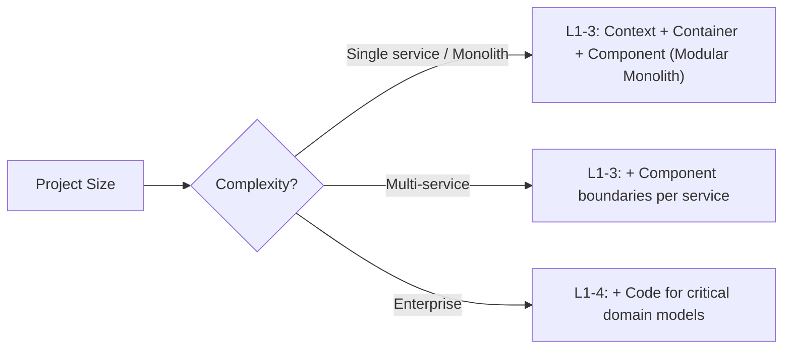

# Architecture Design

Software architecture design across the full lifecycle: design, document, audit, evolve.
Modular-first & illustration-first — prefer clear component boundaries and mermaid diagrams over prose.

Before designing, read [Architecture working principles](references/working-principles.md#architecture). Ground proposals in existing flows and constraints, and distinguish proposed choices from authorized implementation.

**Pre-design human gate:** read-only discovery/research may identify relevant
repository/native/standard-library and established tools, APIs, versions/constraints,
sources, alternatives and custom insufficiency. Present this stack and wait for
explicit human approval before interfaces, schemas, module plans or prototypes.
Require task/scope, proposal revision and human receipt; primary/architect/tool
approval is not a substitute. Reuse an unchanged same-task receipt; changed providers,
material API/runtime constraints or custom exceptions need reapproval. Missing
receipt/source/tool means affected design is `UNVERIFIED`, not custom-fallback authority.
Backward compatibility is OFF unless actual root engineering docs affirmatively
enable it with scope; unavailable root evidence is unknown. Preserve current task
correctness, safety, data and recovery, not legacy contracts by default.

For changed responsibility placement, boundaries or dependencies, apply [Structural integrity](references/structural-integrity.md) before selecting modules and again against the realized design. It owns the shared placement/graph method; builds alone cannot verify architecture.

Progressive disclosure: this file is the workflow router.
Deep detail lives in `references/`.

| When | Load |
|---|---|
| Querying architecture pattern catalog / decisions via CLI | `references/pattern-catalog.md` |
| Selecting an architecture pattern | `references/patterns/INDEX.md` → specific category |
| Modular Monolith & Bounded Context design | `references/patterns/modular-architecture.md` |
| Operational Database Schema Design | Hand off schema-specific requirements and current constraints to a schema-design capability; require ER model, integrity/index decisions, migration compatibility and typed data contracts. If unavailable, keep those decisions explicitly unresolved. |
| Analytical/scientific pipeline stack selection; inspectable DAGs or dataflow lineage | `references/dataflow-stack-selection.md` |
| Local parallelism, distributed workers, Hadoop/Spark, HPC or compute networks | `references/parallel-compute-selection.md` — provisional selection brief, not deployment authority |
| Distributed storage/sync, consensus, CRDTs, content addressing or ledger integrity | `references/distributed-integrity-selection.md` — provisional selection brief, not a security certification |
| Platform already chosen; integrating/using workers, storage/sync or consensus safely | Use an operations capability with the chosen platform/version, workload/invariants, access bounds, commit/retry/resource/recovery contract and observed verification. If absent, do not imply safe deployment or execution. |
| Drawing C4 diagrams | `references/visualization/c4-mermaid-templates.md` |
| Writing an ADR | `references/adr-templates.md` |
| Analyzing tradeoffs or fitness | `references/analysis/fitness-functions.md` |
| Designing an MCP/JSON-RPC tool server | `references/mcp-server-architecture.md` |
| Plugin lifetimes, dynamic dependencies, cleanup or rollback claims, or streaming channel contracts | `references/lifecycle-composition.md` |

---

## Gate 1 — Scope Check

Before starting, determine:

| Question | Action |
|---|---|
| Existing architecture docs? | Read first. Audit before rewriting. |
| DB schema design needed? | Require a schema-design capability with workload, existing schema, consumers and migration constraints; otherwise mark those decisions unresolved. |
| Micro code implementation / class patterns? | Hand off settled boundaries and observable behavior to an implementation capability; this design workflow does not implement code. |
| Code change only, no arch impact? | STOP — skill not needed. |
| Code review request? | Use an independent reviewer with the changed source, acceptance criteria and required evidence; design authors do not self-validate. |

**Orchestrated design (non-trivial or multi-level work):** the main agent does not author and
approve consequential design alone. Follow the level-by-level author → independent review →
approval loop in the planning guidance's [multi-level planning](../working-principles/references/multi-level-planning.md)
(architecture boundaries, then structure, then slices): dispatch a separate design worker and a
separate reviewer per level, give reviewers the original sources, and do not start a lower level
before its parent passes. If delegation or an independent reviewer is unavailable, mark the level
`INCOMPLETE`; do not self-review.

## Gate 2 — C4 Level Calibration & Modular Boundaries

| Project Size | Default C4 Depth for canonical docs | Architectural Mandate |
|---|---|---|
| Single service / monolith | Level 1–3 (Context + Container + Component) | **Mandatory Component breakdown (C4 L3)**: define Modular Monolith bounded contexts & public module APIs |
| Multi-service / microservices | Level 1–3 (+ Component per service) | Define component boundaries & inter-service contract DTOs per deployable |
| Enterprise / platform | Level 1–4 (all levels) | Define enterprise domain contexts, trust boundaries, & data ownership |

---

## Gate 3 — Illustration Budget

Canonical architecture docs that are walls of text have failed. Their minimum diagrams are:

| Artifact | Minimum Illustrations |
|---|---|
| Architecture overview | 1× system context + 1× container diagram + 1× component/bounded context diagram |
| Migration plan | 1× current state + 1× target state + 1× transition sequence |
| Data & Schema architecture | 1× component data flow + 1× ER diagram; schema-specific decisions need an explicit schema-design contract |
| Security review | 1× trust boundary diagram (STRIDE overlay) |
| ADR | 1× options comparison diagram (optional) |

### Diagram Scoping — One Concern Per Diagram

Each Mermaid diagram must represent **one logical concern**. Mixing multiple concerns (e.g., data flow + deployment topology + component relationships) into a single diagram makes it unreadable and defeats the purpose.

**Hard rules:**

- **One concern per diagram**: A diagram covers one of: system context, container boundaries, component internals, data flow, deployment topology, sequence/interaction, or decision tree — not multiple at once.
- **Scannable heuristic (~10–15 nodes)**: When a diagram approaches ~10–15 nodes, treat it as a signal to review whether it is mixing concerns. This is a heuristic, not a hard node count — a well-bounded diagram with 20 nodes is better than splitting a coherent flow arbitrarily. Use judgment: if nodes belong to different concerns, split; if they belong to the same concern, keep together.
- **Split dense/multi-concern diagrams**: When a single diagram spans multiple concerns or becomes dense, split it into logically scoped sub-diagrams — one per concern.
- **Overview-first navigation**: When a topic is covered by multiple sub-diagrams, provide a concise overview diagram (or a brief prose orientation) that names and links each sub-diagram so readers know where to navigate.
- **Illustration-first is preserved**: Splitting does not reduce the illustration count — it replaces one overloaded diagram with multiple focused ones. The minimum illustration budget from the table above still applies.

**Anti-patterns to reject:**
- A single flowchart that shows both runtime data flow and static component ownership.
- A sequence diagram that also encodes deployment zones as swim-lanes.
- A C4 component diagram that annotates every node with data schema details (those belong in the ER diagram).

---

## Workflow Routing

Match the scenario, load only the matching workflow file.

### Common Scenarios (try these first)

| Scenario | Trigger | Load |
|---|---|---|
| **Greenfield design** | New system, no existing architecture | `references/workflows/greenfield.md` |
| **Brownfield documentation** | Existing system, missing/outdated docs | `references/workflows/brownfield.md` |
| **Architecture audit** | Review existing system, fitness check | `references/workflows/architecture-audit.md` |
| **ADR writing** | Consequential, hard-to-reverse choice with credible competing options; record status, context, decision, consequences and owner | `references/workflows/adr-writing.md` |
| **Migration planning** | Monolith→micro, cloud migration, DB migration | `references/workflows/migration.md` |

### Specialized Scenarios (if common ones don't match)

| Scenario | Trigger | Load |
|---|---|---|
| **System integration** | Connecting two systems, API gateway, BFF | `references/workflows/integration.md` |
| **Security architecture** | Threat model, trust boundaries, compliance | `references/workflows/security-review.md` |
| **Performance redesign** | Scaling bottleneck, latency SLO breach | `references/workflows/performance-redesign.md` |
| **API design** | New API, contract-first, versioning | `references/workflows/api-design.md` |
| **Data architecture** | Data modeling, pipelines, governance | `references/workflows/data-architecture.md` |

Default when nothing matches: **brownfield documentation**.

---

## Pattern Selection (Modular Monolith Default)

When choosing an architecture pattern:
1. Default to **Modular Monolith** with DDD Bounded Contexts (`references/patterns/modular-architecture.md`) before breaking into premature microservices.
2. Load `references/patterns/INDEX.md` to explore pattern categories.
3. Query the architecture CSV catalog with an available BM25 search or CSV-aware query capability per `references/pattern-catalog.md`. Resolve catalog paths from the loaded bundle, retrieve bounded candidates, and check their constraints; do not load entire CSV files into context.
4. Enforce **Hexagonal Architecture (Ports & Adapters)** for domain components — domain logic must not depend on databases, HTTP frameworks, or third-party SDKs.
5. Enforce **Explicit Contract DTOs** across component interfaces — positional tuples and untyped dictionaries across module boundaries are forbidden.

---

## Hard Rules

- **Modular Monolith default**: Prefer in-process bounded contexts with explicit interfaces over distributed microservices for single applications.
- **Mandatory Component Breakdown (C4 L3)**: Canonical architecture documentation must not present a single service as a black box without specifying its internal component boundaries.
- **Illustration-first for canonical docs**: Every canonical architecture section MUST have at least one mermaid diagram. Milestone notes follow their lighter diagram rule below.
- **Explicit types over tuples**: Inter-component interfaces must use explicit DTO types.
- **Server-shaped interfaces follow server layering**: keep bootstrap/transport, routing, endpoints, middleware, contracts and streaming channels separate — including MCP tool servers. Protocol ceremony belongs at the boundary, not in handlers.
- **Evidence over aspiration**: Document what IS, mark aspirational targets as "Target State".
- **Locked Plan Core Parts**: When architecture transitions to implementation or migration plans, keep scope and approved behavior always clear; settle concrete code interfaces and file boundaries only where real consumer or handoff coordination needs them, and use separate phase files only for independently delegated or resumable units.
- **Informed alignment for decisions**: Before asking non-trivial choices, reconcile the request with current source and constraints; separate outcome from proposed mechanism, check affected consumers, compare options/consequences and state unknowns or disconfirming evidence. Define C4/DDD/ports-adapters only insofar as terminology affects the decision. Ask only unresolved questions.

### Technical specifications, including spec-only requests

A request for a technical specification or TRD is a design assignment, not implementation authority. Start from the requested outcome, existing system evidence and constraints; a parent product brief is not required. If product intent is genuinely unresolved, obtain the accountable owner's brief/decision and its evidence; do not invent requirements.

Capture the following at the depth needed by affected consumers and operators:

- **Constraints and options**: current state, intended change, scope/non-goals, technical limits, alternatives, trade-offs and why the proposed approach fits. Distinguish evidence from assumptions; record consequential hard-to-reverse decisions as ADRs at the existing threshold.
- **Boundaries and contracts**: component responsibilities, data ownership/invariants, caller-visible inputs, outputs, errors and compatibility. Settle concrete schemas/signatures where real consumers or handoffs need them; do not manufacture exact file trees or DTO inventories for unspecified local helpers.
- **Operational quality**: measurable performance, capacity and reliability targets with workload/measurement conditions; observability, dependencies, failure propagation, recovery and migration/rollback where applicable. “p95 under 200 ms at 1,000 requests/s” is testable; “fast” is not. Unknown targets stay open rather than becoming invented commitments.
- **Security and privacy**: assess trust and privilege boundaries, sensitive data/retention, input validation, secrets/configuration, dependency trust and fail-open/fail-closed behavior. Explain inapplicable concerns rather than leaving a generic security heading empty; use this skill's security workflow for material security design and request a separate security assessment when needed.
- **Verification and unresolved decisions**: explain how the contracts and quality targets will be checked, what evidence is missing, and which owner must resolve blocking choices. Any separately produced behavior/acceptance contract must contain observable outcomes, failure cases and verification evidence; its absence leaves that contract unresolved.

Deliver a narrow engineering note unless the user requests a formal TRD or durable coordination needs one. Use the artifact calibration below for diagrams; a presentation capability may format a saved document without changing its technical meaning. Stop the affected design on contradictory constraints or missing consequential consumer decisions. Do not attach an automatic implementation plan, phase files or child specs; specification completion proves neither implementation nor runtime quality.

### Artifact Level Calibration

The hard rules and illustration budget scale to the artifact being produced or reviewed:

| Artifact | What the rules require | What is out of scope |
|---|---|---|
| **Canonical architecture doc** | Full C4 L1-L3 (system context + containers + components/bounded contexts), complete illustration budget, all hard rules. | Implementation DDL, code, migration scripts. |
| **Milestone architecture note** | Only the touched boundaries, contracts, invariants, data ownership, failure behavior, and a one-step evolutionary runway. Add one diagram only when the relevant interactions are unclear; otherwise concise structured prose is sufficient. Preserve high-risk security, data, and migration requirements. | Canonical C4 completeness, re-documenting unaffected topology, speculative future architecture. |
| **Subsystem engineering design doc (TRD)** | Component-level diagrams for the subsystem scope, ER diagram if schema is involved, scope boundary with contracts settled proportionately to consumer/handoff need, delivery sequence only when requested or needed for coordination (separate files only for independently delegated or resumable units), ADR only for a consequential, hard-to-reverse architecture choice with competing options, dependency direction. Does NOT need to re-draw system context or container diagrams if the canonical architecture doc already has them — reference it instead. | Full C4 L1 system context, container diagram, exact module port interfaces (those are implementation), migration DDL. |
| **Delivery spec / migration plan** | Current-state + target-state + transition-sequence diagrams, scope boundary with contracts settled proportionately, phase sequence (separate files only for independently delegated or resumable units), exit criteria, rollback guidance. | Design rationale, ADR only when the consequential + hard-to-reverse + competing-options threshold applies (defer to TRD), component diagrams (defer to TRD). |
| **Code review (PR)** | Code implements the design correctly: dependency direction, typed interfaces, no black-box components. | Design-level questions (defer to TRD review). |

**Do not fail a subsystem TRD for not containing a full C4 L1 system context diagram.** If the canonical architecture doc (`docs/architecture.md` or equivalent) already covers system context and containers, a subsystem TRD only needs the component-level diagrams, ER diagrams, and decision records relevant to its scope. The TRD's job is to specify *what* and *why* for the subsystem, not to re-document the entire system topology.

### Milestone Architecture Note

Use this artifact for an active delivery milestone when architecture is touched but a full TRD is not justified. It is deliberately narrow and must state:

1. **Touched boundaries and contracts** — callers, owners, and compatibility expectations.
2. **Invariants and data ownership** — what must remain true and which component owns each changed datum.
3. **Failure behavior** — expected failures, propagation/recovery, and fail-open/fail-closed behavior where relevant.
4. **One-step evolutionary runway** — the next credible extension or migration seam, without prebuilding it.

Use one focused interaction, sequence, data-flow, or boundary diagram only when prose would leave the interaction unclear. Do not add C4 diagrams merely to satisfy a milestone note. Security-sensitive changes, material data changes, and migrations retain their applicable security review, data architecture/ER, transition, rollback, and recovery requirements.

---

## Deliverables

- [ ] Current human-approved researched stack/custom exceptions and receipt precede design; scope check passed (Gate 1)
- [ ] Artifact level calibrated: milestone note or canonical/subsystem/migration artifact
- [ ] C4 depth and illustration budget met when producing canonical architecture documentation
- [ ] Milestone note records touched boundaries/contracts/invariants/data ownership/failure behavior and one-step runway when using milestone delivery
- [ ] Modular Monolith / Bounded Context breakdown specified when the artifact's scope needs it
- [ ] Schema design has an ER diagram, explicit constraints and typed data contract; missing specialist capability is marked unresolved
- [ ] ADR written only for a consequential, hard-to-reverse architecture choice with competing options

---

## References

- `references/INDEX.md` — Master index of architecture references
- `references/pattern-catalog.md` — Architecture pattern catalog, decision trees, and anti-pattern traps CLI
- `references/patterns/modular-architecture.md` — Modular Monoliths, Bounded Contexts, Ports & Adapters
- `references/visualization/c4-mermaid-templates.md` — C4 L1-L3 templates
- `references/adr-templates.md` — ADR templates
- `references/mcp-server-architecture.md` — MCP/JSON-RPC tool servers as ordinary servers: bootstrap, router, endpoints, middleware, contracts and streaming
- Handoffs: schema design receives workload, consumers and migration constraints; implementation receives settled boundaries and observable behavior/acceptance contracts; independent review receives source evidence, decision criteria and unresolved risks. Missing owners/capabilities leave relevant work unverified, not waived.
