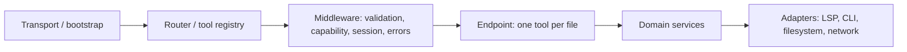

# MCP Server Architecture

Treat an MCP server as a server, not a protocol special case. MCP supplies the wire
contract (JSON-RPC over stdio or HTTP); it does not replace ordinary server layering:
bootstrap, routing, endpoints, middleware, request/response contracts, streaming and
lifecycle. A reader should be able to trace one request through those layers without
learning MCP ceremony first.

Scope: tool-serving MCP servers; resource and prompt endpoints follow the same layering
and contract rules.

## Map established concepts to MCP

| Server concept | MCP realization | Design rule |
|---|---|---|
| Bootstrap / transport | stdio or HTTP transport, server construction, config, shutdown | Keep thin and free of tool logic; own process lifecycle in one place. |
| Router | tool registry (`registerTool` or equivalent) | One registry; stable names; static registration unless runtime discovery is a real user need. |
| Endpoint | one tool handler | One task-shaped action per endpoint; keep input schema, handler and result contract together. |
| Middleware | validation, capability/authorization checks, session acquisition, error normalization, logging | Implement cross-cutting behavior once; handlers orchestrate work, not protocol plumbing. |
| Request contract | input schema (zod / JSON Schema) | Validate at the boundary; use caller-facing units and names; reject unsafe input before side effects. |
| Response contract | bounded structured result | Stable shape, compact payload, actionable errors; do not leak transport objects or internals. |
| Streaming / async signals | notifications, progress, logs | Use protocol channels for progress and logs; keep unary tool results deterministic and bounded. |
| State / sessions | pool or manager owned by the server | Centralize lifecycle, eviction, recovery and synchronization; endpoints request context instead of managing it. |
| Reverse requests | server-to-client requests (`applyEdit`, sampling, elicitation) | Declare an explicit policy; refuse or mediate by default. A read-only endpoint must not mutate disk through a side channel. |
| Observability | logs, stderr, metrics, traces | Keep diagnostics out of user-facing results; bound and redact them. |

## Layering



Dependencies point inward. Endpoints and domain services must not import transport or
registry internals; adapters implement narrow ports. Middleware may depend on contracts
and services, but not on concrete endpoint handlers.

## Layout guidance

For a growing surface, a layout that keeps the flow visible:

```text
src/server.ts          bootstrap, instructions and shutdown only
src/tools/index.ts     router: registers every endpoint
src/tools/<tool>.ts    endpoint: schema, annotations and handler
src/tools/shared.ts    middleware, context and shared response contracts
src/<domain>.ts        services, state and adapters
```

Do not split for its own sake. A small surface can live in one registration module
until navigation cost is real. The test is whether a reader can trace
request -> middleware -> endpoint -> service -> result without jumping through
protocol ceremony.

## Task-shaped endpoints

Expose the actions callers need, not the machinery used to provide them. A tool server
whose tools are `discover`, `start`, `events` and `relist` makes every caller perform
setup; task-shaped endpoints such as `definition`, `references` and `rename` keep the
setup inside the server. Protocol mechanics belong in bootstrap, middleware or a raw
escape hatch, not in the everyday surface.

## Anti-patterns

- A monolithic registration file mixing bootstrap, every schema, middleware and handler.
- Protocol-shaped endpoints that expose setup ceremony instead of user tasks.
- Repeating session, synchronization, position or error plumbing in every handler.
- Dynamic tool registration when a stable registry works; it complicates clients,
  permissions, annotations and tests.
- Read-only annotations on endpoints that can mutate disk or remote state.
- Applying reverse-request side effects without an explicit consent and mediation policy.
- Streaming or progress data mixed into unary results; unbounded payloads.
- Treating MCP as exempt from ordinary API review because its endpoints are "tools".

## Review checklist

- Can each layer be named, and does dependency direction hold?
- Is the bootstrap free of endpoint logic, and is routing declarative and stable?
- Are validation, authorization, session and error concerns implemented once?
- Are request, response and error contracts explicit, caller-facing and bounded?
- Are streaming/progress and reverse requests on separate, governed channels?
- Can endpoints be tested without a real transport?
- Is lifecycle/state ownership centralized, observable and recoverable?
