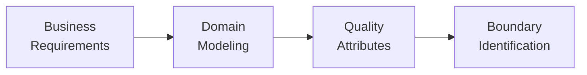
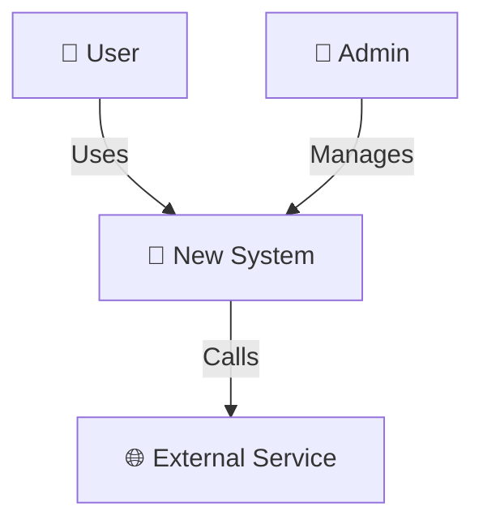
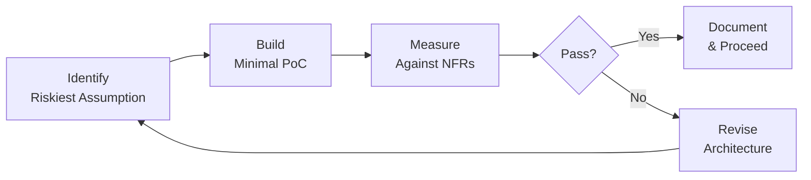

# Greenfield System Design

## When

New system, new major subsystem, or new domain service with no existing architecture.

**Phase and exposure (state inline; no new artifact):** delivery phase (prototype, MVP/first real users, production, or explicitly unknown), who is exposed (local synthetic/private/public-sensitive), core real-user outcomes, non-goals, and known safety/privacy/data/legal/recovery/public-contract obligations. Phase calibrates the depth below; it never waives an obligation. Unknown phase is not prototype or production; ask only for missing context that changes the current design decision and keep affected items open.

---

## Phase 1 — Domain & Requirements Discovery

**Do:**
- Run Event Storming or lightweight domain discovery
- Identify only applicable NFRs (availability, latency, retention) with the phase/workload that makes them material
- Project scale only to the declared phase or known consumer target; if none exists, record unknown and design for current observed load
- Identify compliance boundaries only where declared exposure or legal obligations establish them; do not import regimes speculatively

**Ask:**
- What are the explicit SLA/SLO expectations, if this phase has an operational obligation?
- Does the team have operational mastery of the chosen stack?
- What scale is actually expected for this phase? If unknown, say unknown; do not substitute a default horizon.

---

## Phase 2 — C4 Context & Container Modeling

For a canonical architecture doc, draw C4 Level 1 (System Context) and Level 2 (Container) using `../visualization/c4-mermaid-templates.md`. For a prototype or milestone note, use one focused context/interaction sketch only when it clarifies the tested assumption or a real boundary; do not produce canonical C4 by default.

**Do:**
- Map all human actors and external systems (Level 1)
- Identify deployable units and their technologies (Level 2)
- Show communication protocols between containers

---

## Phase 3 — Pattern Selection

1. Load `../patterns/INDEX.md`
2. Match project concerns to pattern tags (scaling, decoupling, consistency, etc.)
3. Load the relevant category file
4. Document chosen-pattern rationale in the active design; select an ADR only for
   a consequential, hard-to-reverse choice with credible competing options, or
   when explicitly requested or required for regulation/coordination.

**Potential ADR candidates (only at the canonical threshold):**
- Monolith vs microservices vs modular monolith
- Sync vs async communication
- Data store selection
- API protocol (REST, gRPC, GraphQL)

---

## Phase 4 — Architecture Spike

Build an isolated PoC only for a named critical assumption whose resolution is needed for the declared phase.

**Time-box:** the smallest effort that produces the decision; stop when the named assumption is supported or falsified. Do not run a spike without a decision it will inform.

**Validate:**
- The declared NFR/workload, not an invented production profile
- Data consistency guarantees
- Integration with external services
- Operational complexity only to the extent the declared phase/exposure requires it

---

## Phase 5 — Document & Conditional ADR

Produce the applicable subset for the declared phase and artifact. A canonical architecture doc requires the full checklist below; a prototype or milestone note follows the artifact calibration in the skill and does not need full C4 L1–L3, a data ownership table, or an API contract strategy unless the touched scope or a real consumer requires them. Obligations certain from exposure still apply.

- [ ] C4 Context diagram (Level 1)
- [ ] C4 Container diagram (Level 2)
- [ ] Component diagram for critical services (Level 3, if multi-service)
- [ ] Data ownership table
- [ ] API contract strategy (format, source of truth, sync, drift detection)
- [ ] ADR for each consequential, hard-to-reverse pattern/technology choice with competing options
- [ ] Non-goals section (explicit out-of-scope)

**Data ownership table format:**

| Entity | Owned By | Schema Location | Access Pattern |
|---|---|---|---|
| [Entity] | [Service] | [file:line or table name] | [API only / direct DB / event] |

---

## Pitfalls

| Temptation | Mitigation |
|---|---|
| Premature microservice decomposition | Start modular monolith; split when evidence demands it |
| Choosing tech by hype | Evaluate alternatives; create an ADR only when the canonical threshold is met |
| Under-specifying applicable NFRs, or inventing inapplicable ones | Phase 1 must produce measurable quality attributes only where phase/exposure/consumers make them material |
| Running an unbounded spike, or skipping a needed one | Spike only a named risky assumption with a decision bound; a fixed 3-day mandate is not required |
| Designing for speculative scale on day 1 | Design for the declared phase and current observed workload with a clear changeability path; do not prebuild a fixed 2× or 10× target. Revisit when evidence or a declared target requires it. |

## Approvers

Canonical architecture: Principal/Staff Architect, Engineering Director, Security Lead, Product Manager. Prototype or MVP milestone note: the accountable owner plus the applicable safety/data owner; a full specialist panel is not required.
