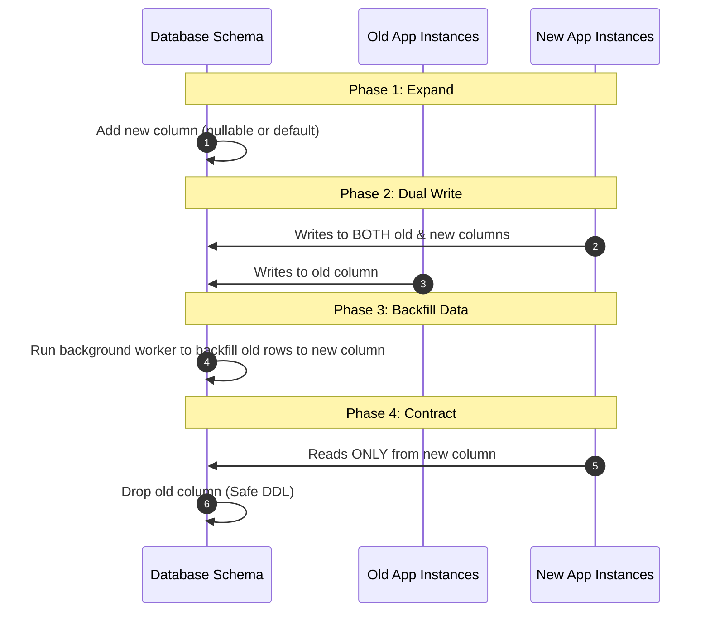

# Recovery-safe schema migrations

First require a human-approved researched engine/driver/migration-tool stack and
an authorized change/recovery plan. Inspect actual root engineering docs: backward
compatibility is OFF unless enabled there with scope; missing evidence is unknown.
Old tests, clients and nested policy do not enable it. Report affected consumers;
investigate unknown required current contracts proportionately and pause dependent
work. Data integrity, safe recovery, lock/availability bounds and destructive-operation
approval remain mandatory even with compatibility OFF. No live DDL is authorized here.

## 1. The Expand-Contract (Parallel Change) Pattern

Use expand-contract when explicitly opted-in rolling compatibility or actual
availability requires old/new coexistence. The four-phase example below is one
conditional technique, not a rule for every schema change. An authorized offline
replacement can instead use a validated backup/restore and cutover plan. Never
infer destructive DDL permission from compatibility opt-out.



---

## 2. Non-Blocking DDL Guidelines (Postgres / MySQL)

Apply to a selected engine/version when non-blocking availability is required;
verify its actual DDL and transaction restrictions. These examples are PostgreSQL,
not portable MySQL syntax or blanket permission to run migrations.

- **Adding Columns**: Always add new columns as `NULLABLE` or with `DEFAULT` values that do not lock the table (Postgres 11+ handles defaults without rewriting the table).
- **Adding Indexes**: Always build indexes concurrently on live tables:
  ```sql
  CREATE INDEX CONCURRENTLY idx_users_phone ON users (phone);
  ```
- **Adding Foreign Keys**: Add foreign keys with `NOT VALID` first, then validate separately to avoid long table locks:
  ```sql
  ALTER TABLE orders ADD CONSTRAINT fk_orders_user 
    FOREIGN KEY (user_id) REFERENCES users(id) NOT VALID;
    
  ALTER TABLE orders VALIDATE CONSTRAINT fk_orders_user;
  ```
